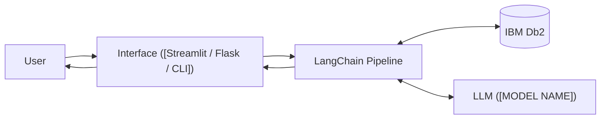

# PolicyPulse: System Architecture

## 1. Overview

PolicyPulse is a LangChain-based application that connects a language model to IBM Db2 so users can [WHAT USERS DO, e.g. ask questions about policy data in plain English]. The overall system and architecture were designed jointly by both team members.

## 2. High-Level Flow

## 3. Components

| Component | Responsibility | File |
|---|---|---|
| Interface | Takes user input and shows the answer | `src/[FILE].py` |
| LangChain pipeline | Builds prompts, calls the LLM, orchestrates the chain | `src/[FILE].py` |
| Db2 layer | Connects to IBM Db2, runs queries, reads/writes data | `src/[FILE].py` |
| LLM | Understands the question and generates the answer | [Provider / model] |
| Config | Reads secrets from environment variables | `.env` (see `.env.example`) |

## 4. Request Flow (step by step)

1. The user enters a question in the interface.
2. The question is passed to the LangChain pipeline.
3. LangChain [generates a SQL query / retrieves relevant records] and runs it on **IBM Db2**.
4. Db2 returns the matching data.
5. LangChain sends the question and the retrieved data to the LLM.
6. The LLM produces the final answer, which is shown to the user.

(Edit steps 3-5 so they match exactly what your code does.)

## 5. Data Model (IBM Db2)

| Table | Purpose | Main columns |
|---|---|---|
| `[TABLE_1]` | [What it stores] | `[col1, col2, col3]` |
| `[TABLE_2]` | [What it stores] | `[col1, col2, col3]` |

## 6. Design Decisions

- **Why IBM Db2:** [e.g. reliable enterprise database for structured policy data]
- **Why LangChain:** [e.g. simple way to chain database access with an LLM]
- **Security:** credentials are kept in environment variables, never committed.

## 7. Limitations and Future Work

- [Limitation 1, e.g. depends on the quality of the stored data]
- [Future work 1, e.g. add Db2 vector search for retrieval]
- [Future work 2, e.g. user login and chat history]
